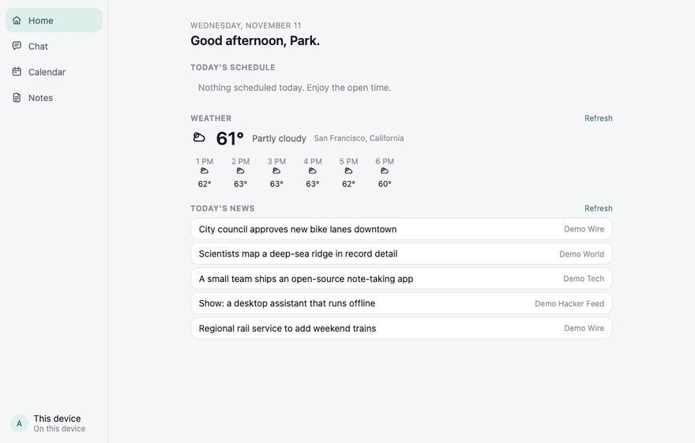
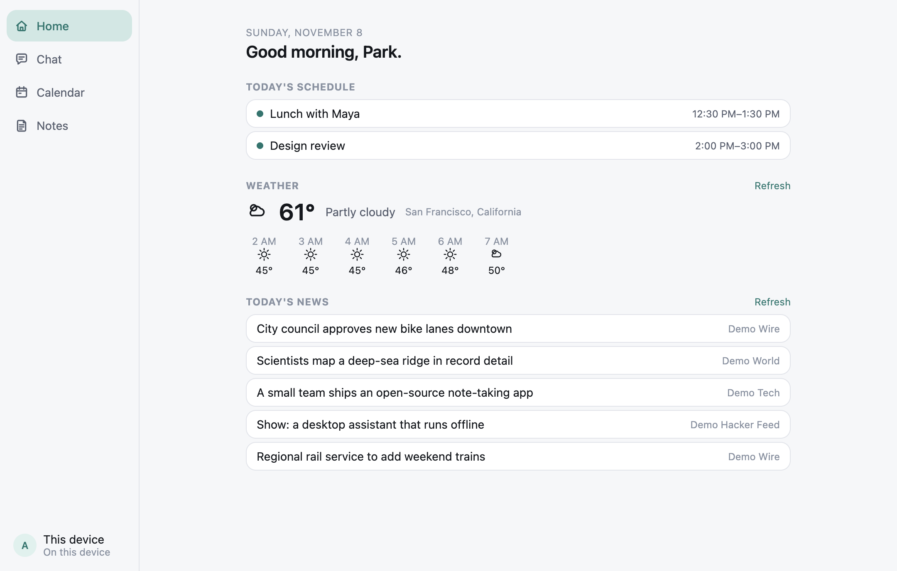
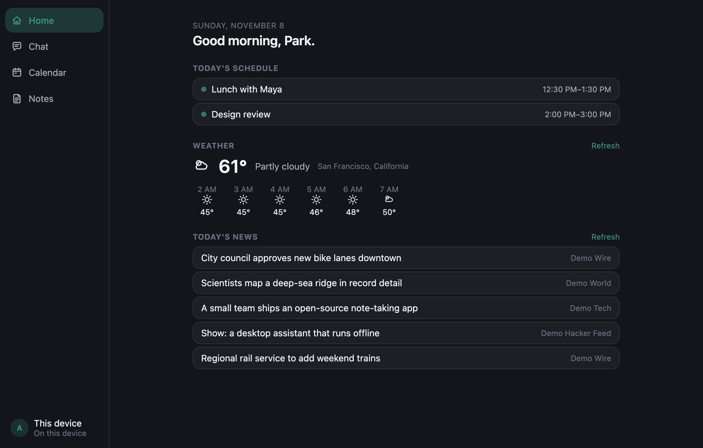
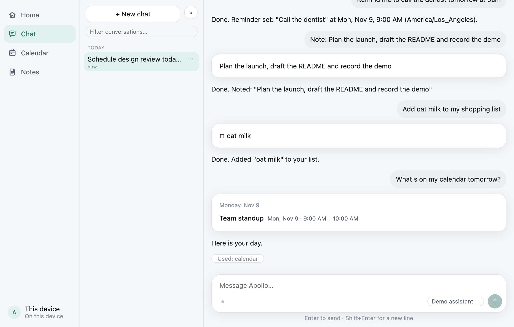
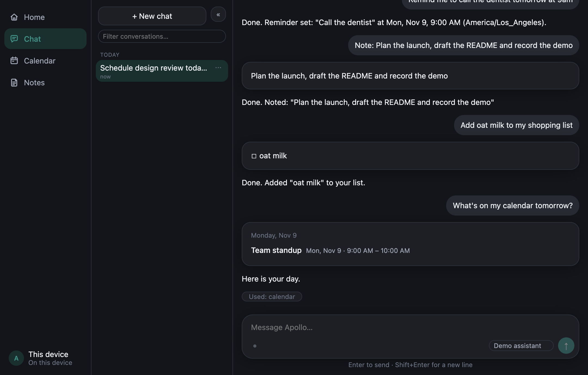
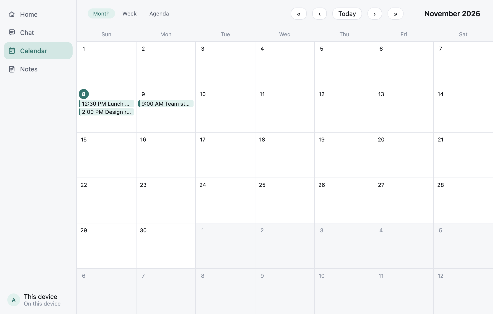
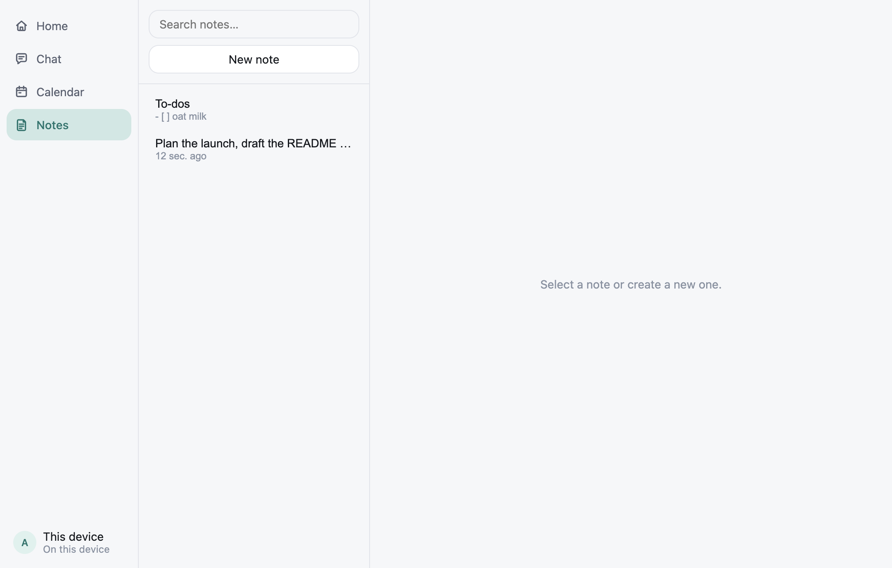

# Apollo

A desktop AI assistant that stays out of your way. A small orb sits at the edge of your screen. Say "Hey Apollo", or hold a key and talk. Or open the Workspace and type. Voice and text share one conversation.

Local-first: your data lives in a SQLite file on your machine, and the app only talks to the hosts listed in Settings, Privacy.



## Why

Most assistants live in a browser tab. Apollo lives where you work, answers in a sentence, and keeps its hands to itself: anything risky waits for your confirmation, and nothing leaves the computer unless you can see where it goes.

## What it does

| | |
|---|---|
| **Talk or type** | Wake word, push-to-talk, or the Chat tab. A spoken exchange shows up live in the open thread. |
| **Plan your day** | Calendar with month, week and agenda views, recurring events, optional Google Calendar sync. Reminders, timers and alarms. |
| **Keep notes** | Notes with search and autosave, quick capture from anywhere in two seconds, no model involved. |
| **Stay informed** | Today view with your schedule, weather and headlines. Voice answers for news and briefs. |
| **Remember** | On-device semantic memory over your notes and chats. Nothing is uploaded to build it. |
| **Stay safe** | Risky actions need your confirmation in code, untrusted text cannot trigger them, and every outside request is checked against an allowlist. |

## Screenshots

| Light | Dark |
|---|---|
|  |  |
|  |  |
|  |  |

## Try it

Needs Node 20+ (developed on 22), pnpm 10+, and macOS or Windows.

```bash
pnpm install
APOLLO_DEMO=1 pnpm dev      # no accounts, no keys, no network
```

Demo mode runs entirely on made-up data. A scripted assistant answers a few everyday requests (events, reminders, notes, list items, "what's on my calendar tomorrow?") and the weather and headlines are built in. It only exists in development builds and never reads real keys.

Plain `pnpm dev` starts the real app. Without keys it falls back to local adapters, so timers, notes, calendar and reminders still work. If your shell sets `ELECTRON_RUN_AS_NODE`, start it with `env -u ELECTRON_RUN_AS_NODE pnpm dev`.

## Checks

```bash
pnpm lint && pnpm typecheck && pnpm test
```

CI runs the same gates plus a dependency audit on macOS and Windows.

## Docs

| | |
|---|---|
| [Setup](docs/setup.md) | Modes, accounts, keys, permissions |
| [Features](docs/features.md) | Voice, Workspace, nudges, quick capture, calendars, memory |
| [Architecture](docs/architecture.md) | Code layout, how a turn flows, security, data safety |
| [Development](docs/development.md) | Scripts and the native module ABI |
| [Decisions](DECISIONS.md) | Why things are the way they are |
| [Spec](SPEC.md), [Progress](PROGRESS.md), [Backlog](BACKLOG.md) | Scope, status, what is left |
| [Human to-do](HUMAN_TODO.md) | The steps that need a person, such as accounts and signing |

## Status

Built phase by phase and committed with tests. The remaining items need a person: accounts, certificates, a physical microphone, Windows hardware. They are listed in [HUMAN_TODO.md](HUMAN_TODO.md). The managed backend is not deployed yet, so account sign-in cannot succeed until it is.
